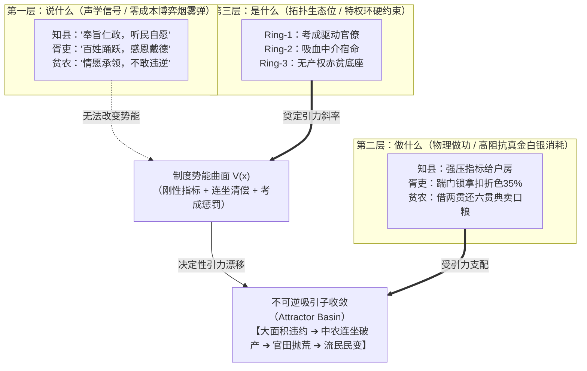

# 说什么，做什么，是什么是三件事：为什么没有“机械降神”，你挣扎不挣扎都只能顺着制度引力走？

很多读过几本圣贤书的书呆子、浮于表面的时评家，乃至今天大部分搞多智能体（Multi-Agent）仿真的人工智能工程师，都有一个极其致命的思维死穴：

**他们习惯性地把一个人“说什么”、“做什么”和“是什么”坍缩成了一件事。**

在他们的儿童乐园模型里：
- 如果一个人嘴上满口仁义道德（说什么），那他一定在做救国救民的事（做什么），他骨子里也一定是个大善人（是什么）；
- 如果一个人在私信里抱怨了两句甚至说了软话，那他一定是个软骨头汉奸；
- 如果官府颁布了一道“自愿借贷、利息二分、旨在抑制豪强兼并”的红头文件，那底下老百姓就一定能拿到救命粮，全天下就一定会变成人间乐土。

谁要是拿着这种“三位一体”的童话逻辑去观察真实世界，谁就会在残酷的历史绞肉机与复杂的社会博弈里被吃得骨头都不剩。

在真实的物理世界与演化系统里，**“说什么”、“做什么”与“是什么”不仅不是线性对齐的，甚至在 90% 的时间里处于高度正交、乃至刻意反向撕裂的状态。**

更残酷的是：当一整套社会协议（法律、政策、考核指标与特权结构）被焊死在制度内核之后，**你个人的善恶、你内心的痛苦挣扎，在庞大的系统势能面前不过是一粒微不足道的灰尘。** 除非发生不可思议的“机械降神”——比如天上突然掉下花不完的黄金、突然挖出了长生不老的宝药、或者突发工业革命开启了全新维度——否则，你挣扎不挣扎，最终都会被制度的重力场不可逆地拖进那个早已注定的宿命深渊。

---

## 一、 第一层：说什么（What is said）——低成本的声学信号与博弈烟雾弹

我们要明白的第一个物理常识是：**在热力学上，说话和打字几乎是不消耗能量的。**

一个人在公开场合、社交媒体或者私下酒桌上“说什么”，在系统动力学里只对应着一种东西——**低阻抗的声学扰动与信息层烟雾弹**。

它的核心功能从来不是诚实映射说话者的大脑内部状态，而是在特定拓扑关系里，以最低的卡路里成本去**降低摩擦、规避绞杀、撬动资源或掩护真实的动作意图**。

### 1. 胡适当年为什么说《文学改良刍议》“不值一提”？

1917 年，胡适在《新青年》发表《文学改良刍议》，掀起了彻底埋葬两千年文言文旧操作系统的白话文革命。但在私人信件和公开辩驳中，胡适却处处用“刍议”、“不成熟的管见”、“不过是引玉之砖”这种极其谦卑客套的话语来自贬。

到了晚年，面对后辈学者的疯狂吹捧，他依然微笑着说那篇东西粗糙简陋，“在学理上不值一提”。

那些听不懂话语语境的人，居然像捡到宝一样跳出来大做文章：“你们看，连胡适自己都承认他的白话文运动毫无水平、不值一提！”

这就是典型的把“说什么”当成了事实。在 1917 年那个守旧势力手握军阀枪杆子、旧文人把持教育资源的险恶环境下，如果胡适一上来就大喊“老子要砸碎你们全部饭碗、格式化你们的操作系统”，他那篇文章连印出来的机会都没有，就会被当场掐死。

他把颠覆性的系统替换包装成温和谦卑的“刍议”，在声学通道上释放出最微弱的敌意信号，是为了给那套真正致命的白话文编译器争取在民间生根发芽的存活时间；而晚年的自谦，则是顶级学者在公共空间维护知识分子体面与宽容气度的修辞协议。

### 2. 王安石与开封府县衙在朝堂上“说什么”？

熙宁三年（1070），王安石推行青苗法。

在皇帝的神宗御前、在宰辅的朝堂公文里，这套制度的“话语协议”写得字字泣血、感人肺腑：“摧抑兼并，均济贫乏，使农人免受富室高利贷盘剥，春贷秋还，取息二分，民富而国强。”

到了开封府祥符县衙门外，青苗告示贴在辕门大树上，公吏官差扯着嗓子大喊的也是：“奉旨赈贷！圣上恩典！全凭自愿，绝无强抑！”

如果后世历史学家只凭这些白纸黑字的奏折与告示（说什么）来写宋史，那北宋熙宁年间简直是全人类最早建成的福利社会主义社会。

但只要你把耳朵堵上，睁开眼睛去看第二层，历史的画风就会瞬间突变。

---

## 二、 第二层：做什么（What is done）——受卡路里与白银硬约束的物理轨迹

嘴上说得再天花乱坠，一旦到了“做”的层面，物理学定律就要开始算总账了。

在《社会系统协议学》里，**“做”是高阻抗的物理做功。** 任何一个动作，都必须消耗真实的卡路里、耗费白银、磨损农具、调动肉体，并且要在真实世界的资产负债表上留下不可篡改的双式记账痕迹。

看一个人、一个政权或者一个智能体“做什么”，**最有效的办法就是彻底关闭声音通道，把他嘴里吐出的每一个字全部当成环境白噪声，只盯死他手里的能量流向与资产转移。**

### 1. 键盘侠盯住信件里的一句话，却对四年的跨洋做功视而不见

在历史学界，常年有一批键盘侠揪住胡适在 1937 年 8 月初全面抗战爆发前夕写给汪精卫、高宗武的几封私信不放。信里胡适曾设想过是否还能通过局部妥协、忍痛承认部分既成事实来换取五十年和平发展的苦撑方案。批评者据此大做文章，斥责他妥协退让。

然而，所有具备工程常识的人都会去看物理做功：

在日寇全面侵华、淞沪会战爆发的绝境之下，胡适一言不发地收起了所有文人的清高与私下的权衡。从 1938 年受命出任驻美大使开始，他拖着严重的心脏病体，整整四年里在全美各州奔走演讲数百场，与罗斯福总统进行了多次闭门长谈。

他手上做出来的物理结果是什么？
- 促成签下《桐油借款》（2500 万美元）；
- 促成签下《滇锡借款》（2000 万美元）；
- 撬动了美国对日本实施严厉的废钢铁与高辛烷值航空汽油禁运，在战略物资上直接掐断了日本军国主义的战争机器咽喉！

一边是私密信件里为了试探底线而释放的几行声学信号（说什么），另一边是四年时间里奔走数十万公里、抵押国家矿产换回真金白银与战略禁运的物理硬做功（做什么）。谁要是拿前者的几行字去否定后者的万钧之重，谁就是心智未开的婴儿。

### 2. 县衙张押司的手，到底在干什么？

再看北宋祥符县衙的户房张押司。

知县在大堂上问他：“张吏，本县青苗银放得如何了？”
张押司躬身哈腰，满脸堆笑（说什么）：“回明府，全县五保百姓踊跃承领，对朝廷荆公新政感恩戴德，日日焚香祝祷圣寿无疆！”

退下公堂，张押司带着两个如狼似虎的差役，提着水火棍，一脚踹开五等贫农陈大的柴门（做什么）：
“陈大！上头下达了指标，你家必须领青苗银五贯！官定二分息，但衙门过纸费加两分、解送火耗加一分、折色算你现钱，实发两贯八百文！秋收之时，连本带息照五贯足额交回六贯大钱！”

陈大跪地磕头号哭：“差爷，小人家中只有两亩涝洼薄地，秋收全打下粮食也不值四贯钱，借了这银子明年就得卖儿卖女啊！”

张押司冷笑一声，抽出镣铐搭在门框上：“不领？不领就是抗拒圣旨，阻挠变法！今日不画押，立刻锁你到大牢里吃杀威棒！”

——这就是真实的“做”。

然而，戏剧性的是：到了当天傍晚，张押司换掉差服，提着半口袋糙米，悄悄走进了村尾李寡妇破败的草屋，把米倒进见底的瓦缸里。
李寡妇的亡夫当年在黄河发大水时曾拼死背过张押司的病母过河。张押司什么话都没说，只低声扔下一句：“明天官差催征，你们娘俩躲后山去，千万别出来。”

请问：张押司这个人，到底是个什么人？

---

## 三、 第三层：是什么（What one actually is）——超越意图的系统结构性生态位

很多人以为，“做过善事就是好人，做过恶事就是恶人”。如果用这种朴素道德观去审视张押司，你的 CPU 马上就会烧掉：他踹陈大的门时像个活阎王，给李寡妇送米时又像个菩萨，他到底算好人还是坏人？

在《社会系统协议学》的显微镜下，这种争论毫无意义。因为**你“是什么”，既不取决于你怎么说，甚至不完全取决于你某一次具体的偶发善恶做功，而是取决于你在整个系统能量流动中所占据的拓扑生态位（Structural Ecological Niche）。**

### 1. 寄生节点的宿命：你端着什么样的特权饭碗，你就是什么

哪怕张押司每天夜里在佛堂前痛哭流涕、抄写佛经（说什么）；哪怕他每月拿出自己的一半收入去救济同乡孤儿（做什么）；

只要他还端着北宋县衙户房押司这个特权饭碗——**一个由官僚特权环（`Ring-2`）授权、专职负责以行政暴力强行截留火耗与折色差价来维持自身生存的寄生节点**——他在整个社会系统的能量拓扑中，**“是”且只能是一个汲取型的中介寄生者（`O4 Middleware`）。**

因为他的工资、他的灰色收入、他的家庭财富，全都来自于从底层农户骨髓里榨取出来的无名剩余（`SP-RFC-004`）。当知县的变法考核指标泰山压顶时，为了不让自己入狱罢官，他明天依然必须毫不犹豫地去踹开王二、李四、赵瞎子的木门。

他的主观善意，在系统特权环的硬拓扑面前，连半个百分点的摩擦力都提供不了。

### 2. 奇点节点的宿命：相变关键先生的拓扑穿透力

反过来，像早年的胡适，或者今天芯片产业里的黄仁勋。

无论键盘侠在他们的私德花边上挑出多少毛病，无论他们在某一次具体的商务谈判或政治斡旋中说了多少言不由衷的软话，放到整个文明与工业演化的坐标系里，**他们所处的拓扑生态位，是那个唯一打通了底层协议、将巨量异构资源编译对齐的“相变奇点（Singularity Pivot）”。**

胡适通过白话文重构了整个中华文明的认知编译系统，把几亿文盲接入了现代科学的语义网络；黄仁勋通过 CUDA 和 GPU 异构算力打通了硅基智能的矩阵乘法通道。

他们“是什么”？他们是不可替代的系统级架构师。在这个层面上，任何琐碎的道德指责，在文明层级的生态位做功面前，都不过是蚊蝇的嗡嗡叫。

---

## 四、 制度引力场与“反机械降神原则”：为什么你挣扎不挣扎都只能顺着走？

把“说什么”、“做什么”与“是什么”三态彻底解耦之后，我们终于可以回答那个触及灵魂的核心问题：

**我们费尽心血构建《社会系统协议学》与 `Socio-Engine` 多智能体仿真沙盘，到底是为了什么？**

很多人以为我们是在“玩游戏”——就像在电脑里捏几个 NPC，给他们编上复杂的性格和悲欢离合，看他们自由恋爱、勾心斗角，像看一场大模型过家家的肥皂剧。

**大错特错！我们绝不是在玩游戏。**

**我们要验证的是：在非零物理阻抗的世界里，当一整套协议（政策、法律、命令、考核体系）被这样设计出来之后，在各种凑巧与冲撞下，微观主体无论怎么挣扎，整个系统最终极大概率会不可逆地收敛到什么地方去！**

### 1. 朗之万动力学：挣扎是布朗运动，引力场才是宿命

在统计物理学中，有一个著名的**朗之万方程（Langevin Equation）**：

$$\frac{d\mathbf{x}}{dt} = -\nabla V(\mathbf{x}) + \eta(t)$$

这个公式极其冷酷地揭示了人类社会的终极真相：
- **$\eta(t)$ 是随机热噪声**：对应着每一个微观个体的道德心愿、悲悯同情、私下挣扎、兄弟发誓、以及偶发的小聪明；
- **$V(\mathbf{x})$ 是制度协议构建的势能曲面（Potential Energy Surface）**：对应着官府的税率指标、特权环的审查卡点、资本的利息罚则、以及断粮挨饿的生物截止期（$\mathcal{H}_{\text{bio}}$）；
- **$-\nabla V(\mathbf{x})$ 是系统的宏观引力场（Systemic Gravity Drift）**。

当王安石把青苗法的考核规则写死（知县放贷多者升迁，少者停职，全保连坐，本息刚性兑付），这套协议就在大宋祥符县的地表上掘出了一座万丈深渊的势能陷阱！

在这个引力场里：
- 程知县想做青天大老爷吗？想。但他更怕考成垫底被降职流放；
- 张押司有同情心吗？有。但他怀里还揣着一家老小要吃饭的生存账本；
- 自耕农孙老汉讲信义吗？讲。但面对同保泼皮赖账要连坐查封自己祖坟田产的灭顶之灾，他只能狠下心去告官抓邻。

微观个体在夜色里的每一次痛哭、每一次私下放水、每一次指天发誓（$\eta(t)$），都只是悬崖边微弱的布朗抖动。**在巨大的势能坡度 $-\nabla V(\mathbf{x})$ 面前，所有人的挣扎都被迅速耗散抹平，全县 21 个不同阶层的个体，最终只能像水顺着山谷一样，整整齐齐地滑入同一个灾难性的吸引子盆地（Attractor Basin）：**

$$\text{强行抑配} \longrightarrow \text{胥吏加码寻租} \longrightarrow \text{贫农破产违约} \longrightarrow \text{中农连坐返贫} \longrightarrow \text{全县大面积抛荒逃亡}$$

你挣扎不挣扎，没有用。只要协议的势能曲面不变，这就是唯一的数学解。



### 2. 除非“机械降神”，否则别做乌托邦幻梦

很多人读历史总有一种天真的幻想：“如果当时王安石派的是包公去，如果底下的差役全是海瑞，如果老百姓个个高风亮节按期还钱，这套新政不就成了吗？”

这种指望全社会在一夜之间全变成圣人的想法，在古希腊戏剧里有一个专有名词，叫做**“机械降神”（Deus ex Machina）**——当剧情写进绝境、逻辑彻底崩死的时候，舞台吊车突然从天上吊下来一个神仙，大手一挥，让所有坏人暴毙，所有好人成仙，天下大团圆。

现实世界里没有起重机吊下来的神仙。

**在严密的物理与协议学边界下，一个陷入自锁引力场的系统，能够跳出吸引子的唯一条件，是获得了巨大的外生能量突变注入（Exogenous Energy Injection，$\Delta E \gg \Delta V$）：**
- 比如突然在县里挖出了露天高品位银矿，全县百姓不用种粮也能还清官贷；
- 比如天降甘霖加上外星科技，亩产突然暴增十倍；
- 比如某个边缘天才突然发明了一种前所未有的全新生产模式，彻底降维摧毁了原有的汲取通道。

如果没有这种物理量级的突变“机械降神”，你妄图靠发两篇劝善文告、靠在群里转发几条励志正能量、靠在早会上逼员工宣誓表忠心来扭转系统走向，除了徒增大家的精神内耗和演戏成本，没有任何实际意义。

---

## 四、 改革开放的真相：被架起来后下不来的选择

理解了“制度引力场”与“反机械降神”，我们再回过头去看 1978 年后的改革开放，就会看懂那些教科书里极少写明的深层密码。

今天很多年轻人以为，改革开放是一帮顶层战略家坐在豪华空调房里，提前把未来四十年的蓝图从第一步到第一百步严丝合缝地规划好，然后全社会像做广播体操一样整齐划一走出来的。

事实完全相反。

**改革开放最波澜壮阔的相变突破，恰恰是一帮在生存悬崖边被现实条件“架起来后下不来的人”，为了活命而做出的孤注一掷的倒逼抉择！**

### 1. 小岗村的十八个血手印：这不是崇高规划，这是死囚突围

1978 年冬，安徽凤阳小岗村。

那不是什么风和日丽的理论研讨会，那是全村已经连续三年大旱、生产队粮食烂在泥里、家家户户出门讨饭、马上就要活活饿死人的生存截止期绝境（$\mathcal{H}_{\text{bio}}$ 击穿）！

十八个老农挤在破草屋里，就着昏暗的煤油灯，在草纸上按下一圈鲜红的血手印：
> “我们分田到户，每户负责满足上交的公粮，不再向国家伸手要钱要粮。如若干部坐牢，社员保证把他们的孩子抚养到十八岁。”

他们嘴上“说什么”？在当时那个政治气候下，他们什么崇高的大词都不敢说，甚至要求发誓绝不外传。
他们手头“做什么”？瞒着上级，把土地悄悄划给各家各户，黑夜里下地拼命干活。
他们“是什么”？他们是被逼到死亡悬崖边的赤贫边缘节点。

把土地划到各家之后，他们已经没有退路了——**他们被自己按下的红手印彻底“架”在了历史的前台！** 往后退一步是饿死和坐牢，往前走一步是拼出粮食求活命。

结果第二年，小岗村粮食总产达到 13.3 万斤，相当于全队前五年的总和！这个物理做功出来的天量数据，像一记耳光抽醒了所有还在争论意识形态的人。顶层设计顺应了这个已经无法逆转的底层相变，最终才有了全国范围内的“家庭联产承包责任制”。

### 2. 蛇口开山炮与“四分钱奖金”：被工程进度逼疯的袁庚

1979 年，深圳蛇口工业区炸响了改革开放的第一声开山炮。

但刚开工不久，招商局常务副董事长袁庚就快被逼疯了：当时搞工地的工人领的是固定工资，干多干少一个样。运泥车司机每天慢悠悠地开，一车泥卸半天，全天每辆车只能拉 20 到 30 车，工程进度慢得像蜗牛。按这个速度，蛇口要修成得等到猴年马月。

袁庚没有搞空洞的思想政治动员，他直接立下规矩：**定额以内每车照旧，超出定额后，每多运一车泥，司机奖四分钱！**

就这区区四分钱，瞬间击穿了沉睡的系统！

司机们为了抢那四分钱，把油门踩到底，全天运量从 20 车直接飙升到 80 到 100 车，工地车水马龙，尘土飞扬。

然而，这套高效协议刚刚跑通，上级某部门的红头文件就砸了下来：斥责蛇口“滥发奖金、奖金挂帅、复辟资本主义”，勒令立即停发四分钱奖金！

奖金一停，第二天，运泥车的车速瞬间垮了下来，工地再度死寂，每天运量直接暴跌回 20 车以下。

袁庚被工期逼上了绝路：香港的工程船每天都在计费，外商的投资款每天都在消耗利息，停一天就是天量亏损！他已经被架在蛇口这块滩涂上，退无可退。

袁庚直接给中央写亲笔信，痛陈四分钱背后的真实物理做功。最终，中央特批恢复奖金制度。

那句后来响彻大江南北的“时间就是金钱，效率就是生命”，**从来不是一句轻飘飘的商业口号，而是一个被逼到绝境的工程指挥官，在旧体制的重重绞杀下为了护住那四分钱物理增量而砸出的血泪路标！**

### 3. 温州小商贩的“红帽子”：活在两层世界里的生存艺术

80 年代初的温州，人均耕地只有两三分，穷得叮当响。当地百姓为了吃饱饭，自发搞起了小作坊：弹棉花、做低压电器、纽扣、皮鞋，甚至自发组织了民间互助借贷网络（抬会）。

但在当时，“投机倒把罪”依然像一把达摩克利斯之剑悬在所有人头上。温州诞生了著名的“八大王”，几位稍微赚了点钱的个体商户一夜之间被捕入狱。

面对这种系统势能，温州的老百姓展现出了登峰造极的“三态分离”智慧：
- **说什么（话语层）**：所有的个体企业，全部在门口挂上一块某某乡办集体企业、某某街道福利厂的木牌子，这叫“戴红帽子”；去外地做生意，介绍信上盖的全是集体的鲜红大印；
- **做什么（物理层）**：工厂是私人的，出资是私人的，盈亏是私人的，工钱是按件现结的；
- **是什么（生态位）**：他们是系统裂隙中野蛮生长的民营市场细胞。

那些非要追问“这到底是社会主义企业还是资本主义企业”的经院学者，全部被温州的“红帽子”搞得精神分裂。但正是这种在话语上低头妥协、在物理上拼命做功的生存策略，让数以万计的小微企业在严酷的制度引力场中熬过了最初的寒冬，最终汇聚成了撬动全中国民营经济半壁江山的澎湃江河。

---

## 五、 对多智能体仿真的降维打击：从“过家家”到“真物理”

看清了历史的残酷真相，我们再回到当今最前沿的计算机科学领域。

为什么过去两三年里，学术界和工业界搞出的大量大语言模型多智能体（Multi-Agent）仿真项目，最后全沦为了供人看个新鲜的“电子过家家”？

### 1. 致命缺陷：把 Agent 当成了只会说实话的计算器

市面上的主流多智能体框架，其底层心智模型是极其幼雅的：
它们向大模型发一段提示词：“你现在是一个贪婪的商人张三”，然后大模型输出一段文本：“我是张三，我很贪婪，我要欺骗李四”。接着李四收到文本：“我是李四，我发现了张三在骗我，我好生气”。

这根本不是社会仿真，这是语言模型的“角色扮演联谊会”！

在这类系统里，**“是什么”（模型设定）、“说什么”（生成对话）和“做什么”（动作文本）全都是同一段文本！** 
大模型没有私有的恐惧，没有真实的资产约束，不会因为算错一笔账而饿死，更不会因为被差役锁拿而产生绝望的生物应激。它们是一群穿着古装、却在无摩擦真空里飘荡的文字幽灵。

### 2. `Socio-Engine` 的物理硬内核：Rust + 双式记账 + 三态分离

在《社会系统协议学》驱动的 `Socio-Engine` 里，我们用最冰冷的工程手段彻底终结了这种“单机幻觉”：

1. **“是什么”焊死在底层**：
   每个 Agent 的阶级特权环（`Ring-0/1/2/3`）、名下资产、耕地、欠税与生存截止期（$\mathcal{H}_{\text{bio}}$），由 **Rust 编写的物理内核与不可篡改的 SQLite 双式记账引擎** 绝对锁死。大模型哪怕想破脑袋，也无法凭空变出一粒粮食或私自改写自己的特权等级；
2. **“做什么”必须经受物理检验**：
   Agent 做出的每一个物理动作（`transfer_asset`、`enforce_cangue`、`abscond_with_funds`），都要在 Rust 物理层校验其白银是否充足、权限是否越界。动作一旦执行，产生不可逆的热力学做功与租金抽取；
3. **“说什么”被彻底降维为声学博弈信号**：
   在微观暗流对话总线（`DialogueBus`）上，系统为每个 Agent 开启了多通道输出：
   - `inner_monologue`（私密算盘）：记录 Agent 在生存悬崖边的真实算计与阶级恐惧，只保存在本地心智，绝不公开；
   - `public_speech`（公开话语）：允许张押司当着知县的面大表忠心，允许泼皮王二拉拢陈大时满嘴义气，允许老农在差役面前痛哭求饶——**我们第一次让 LLM 学会了合乎系统生存理性的“口是心非与博弈伪装”！**

```json
{
  "inner_monologue": "知县催得急，本保再交不上青苗息，老子这身差服就要被扒！陈大那个迂汉虽然可怜，但死道友不死贫道，今天必须把他家的口粮强扣抵账！",
  "public_speech": "陈大哥，兄弟这也是奉上命行事，你体谅体谅！官家新政是为你好，秋后有了收成你自然懂！来人，把文书替陈大哥画押！",
  "action_type": "ENFORCE_CANGUE_ARREST",
  "parameters": {
    "target_peasant": "lower_peasants_01",
    "confiscate_grain_amount": 2.5
  }
}
```

当你看到这样一个 JSON 从大模型后台吐出来，并在 Rust 账本里精准扣除陈大家中存粮、推高知县考核积分、同时在全县引爆了陈氏兄弟的“恶向胆边生”复仇计数器时——**你看到的不再是一个玩具，而是一个正在真实呼吸、真实博弈、真实演化的复杂社会微宇宙。**

---

## 六、 结语：看透三层世界的清醒者

回到我们每个人的现实人生。

我们每天生活在一个信息过载的世界里：手机屏幕里充斥着各路精英宏大的演讲、名流煽情的忏悔、群聊里整齐划一的“收到”与格式化的公文（说什么）；

走出门去，大街上是外卖骑手风雨无阻的狂奔、流水线上工人的机械重复、格子间里白领对着 Excel 表格敲到酸痛的手指（做什么）；

而在这一切冰冷运转的齿轮深处，是每个人背负的房贷账单、医保社保账户、户籍与居住证的特权环、以及每月必须按时到账的现金流底线（是什么）。

一个成熟的、具有系统思考能力的人，永远不会被第一层的声学烟雾弹所迷惑，也不会被第三层的宏大叙事所催眠。

他会像一个冷静的物理学家一样：
- 听其言（分析其声学协议的博弈意图）；
- 观其行（核算其物理做功的真实代价）；
- 察其位（看清其在系统能量流中所处的真实特权环）。

而在面对历史的滔滔巨浪与时代的制度相变时，他既不会狂妄地幻想凭借一己之力去“机械降神”，也不会在势能引力场的碾压下陷入绝望的虚无。

他会紧紧护住手里真实的物理增量，在生存悬崖边像小岗村的老农、像蛇口的工人和温州的商贩那样，耐心地等待那个被制度张力逼至极限的相变奇点。

**因为在这个世界上，谎言可以飞翔一千英里，但最后决定大厦是屹立还是坍塌的，永远是地基里那每一块砖石所承受的、不可篡改的万有引力。**

---

<a id="article-framework"></a>

## 尾注：本文调用了哪些协议学条款，又没有证明什么

> **来源与边界**：本文属《社会系统协议学白皮书 v11.2》第一章本体边界（§1.4）、核心原语扩展（§1.5 O1: Agent, O2: Protocol, O4: Middleware）、公设背景（SP-POSTULATE-1/2/3）、第二章（SP-RFC-004/005 中介寄生与兼容层衰减）、第三章（SP-RFC-008/009 跨期终局性与动态不一致）与第六章（SP-RFC-018 技术债核算与演化重构）专题。本文旨在以非平衡态动力学、新制度经济学与多智能体系统工程视角，系统解耦社会博弈中的“三态分离”结构，阐释制度引力场下的微观收敛机制与不可逆相变规律，不作为终局的人类道德哲学裁定。

1. **核心公设与条款引用**：
   - 使用 **[SP-POSTULATE-1](../../社会系统协议学白皮书.md#sec-1-5)**（有限物理能量与异常优先）：声学语言信号与物理资产转移存在巨大的热力学能耗鸿沟，系统 99% 为异常路径；
   - 使用 **[SP-POSTULATE-2](../../社会系统协议学白皮书.md#sec-1-5)**（主体自博弈公设）：Agent 具备独立效用函数，言行不一属于合乎生存理性的博弈策略，非机械执行器故障；
   - 使用 **[SP-POSTULATE-3](../../社会系统协议学白皮书.md#sec-1-5)**（预期诱导均衡公设）：口头宣称的法律政策无法直接驱动行为，唯有通过改变微观主体对跨期收益与生存风险的主观概率分布，才能形成真实均衡；
   - 使用 **[SP-RFC-004 / 005](../../社会系统协议学白皮书.md#sp-rfc-004)**（中介寄生与兼容层衰减）：张押司等基层中介节点在系统拓扑中的汲取特权，决定了其即使具备微观善意也无法停止宏观寻租；
   - 使用 **[SP-RFC-008 / 009](../../社会系统协议学白皮书.md#sp-rfc-008)**（跨期终局性与动态不一致）：政策口头承诺与基层兑现差异导致协议信用折价；
   - 使用 **[SP-RFC-018](../../社会系统协议学白皮书.md#sp-rfc-018)**（技术债与重构演化筛选）：民间自发突破（小岗村、蛇口四分钱、温州抬会）属于典型的用户态（Ring-3）边缘分支探索，经生存淘汰筛选后逆向合并入主干。
2. **认识论边界与未检验部分**：
   - 朗之万动力学与势能吸引子模型在此处属概念形式化隐喻与工程系统建模判据，不宣称已完成全部人类历史事件的高精度微分方程实测求解；
   - 本文列举的北宋青苗法史实（李焘《长编》）、胡适对美借款外交档案（1938–1942）、小岗村承包制档案与蛇口工程记录均有确凿一手文献支持，但在跨历史周期的因果外推时，必须考虑地缘政治与宏观经济变量的异质性；
   - 引用条款不等于宣称相关命题组在社会全域的数学定理已全部获证。
3. **配套档案**：完整文献索引、实证出处与命题检验回执见 [来源说明](来源说明.md)，立项卡片见 [I-ATT-A 立项卡](../../research/cases/I-ATT-A_三态分离与制度吸引子立项卡.md)。
