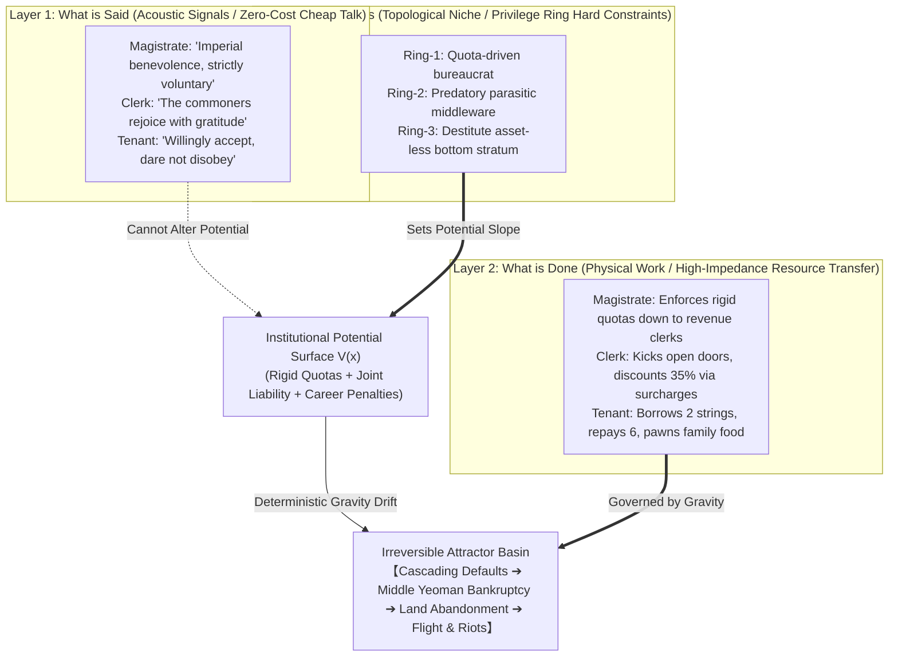

> **Translation record**
> - Chinese source: `articles/say-do-be/说什么做什么是什么是三件事.md` (sha256 `c4c0bb6f...`, 2026-11-12)
> - Chinese version / release tag: `v11.2-r20261106` (theoretical version remains v11.2)
> - Translation version: `en-v0.1`
> - Translation date: 2026-11-12
> - Check status: checked sentence by sentence against the Chinese source for claim status, negative guardrails and numbering; machine and glossary checks only; no independent professional native-speaker review
> - Pending sync: synchronized in public-files.json / mkdocs.yml
> - Status: complete translation
> - Authority: the Chinese SSOT is authoritative; this translation does not constitute a separate set of definitions (C2)

# What is Said, What is Done, and What One Actually Is Are Three Different Things: Why Without a "Deus ex Machina", You Must Follow the Institutional Gravity Drift Whether You Struggle or Not

Many bookish pedants, superficial commentators, and even mainstream AI engineers building multi-agent simulations suffer from a fatal cognitive blind spot:

**They habitually collapse "what is said", "what is done", and "what one actually is" into a single, unified thing.**

In their kindergarten mental model:
- If someone's mouth is full of benevolence and righteousness (*what is said*), they must be doing noble deeds to save the nation (*what is done*), and in their bones they must be a virtuous saint (*what one is*);
- If someone vents frustration or utters a soft compromise in private correspondence, they must be a spineless traitor;
- If the imperial court issues a red-stamped decree promising "voluntary lending at 20% annual interest designed to suppress monopolistic usury", then the commoners will inevitably receive relief grain, and the land will turn into an earthly paradise.

Whoever applies this "trinitarian" fairy-tale logic to observe the real world will be chewed up and swallowed whole by the merciless meat grinder of history and complex social gaming.

In the real physical world and evolutionary systems, **"what is said", "what is done", and "what one actually is" are not linearly aligned; in fact, more than 90% of the time, they exist in a state of high orthogonality, or even deliberate, diametrical opposition.**

Even more brutally: once an entire social protocol—laws, policies, key performance metrics, and privilege structures—is hard-welded into the institutional core, **your personal virtue or malice, and the agonizing struggles of your soul, are nothing more than microscopic dust in the face of immense systemic potential energy.** Unless an extraordinary *Deus ex Machina* occurs—such as gold suddenly raining from heaven, an immortal elixir being unearthed, or an industrial revolution opening up an entirely new dimension—whether you struggle or not, you will inevitably be dragged by the institutional gravity field into a preordained attractor basin.

---

## I. The First Layer: What is Said — Low-Cost Acoustic Signals and Game-Theoretic Smoke Screens

The first physical common sense we must grasp is: **in thermodynamics, speaking and typing consume almost zero energy.**

What an individual "says" in public forums, on social media, or across a private tavern table corresponds to only one thing in system dynamics: **low-impedance acoustic perturbation and informational smoke screens.**

Its core function is never to provide a faithful, transparent mapping of the speaker's internal neurological state. Rather, within a given topological relationship, its function is to use minimal caloric cost to **reduce friction, evade decapitation, leverage resources, or conceal real operational intent.**

### 1. Why Did Hu Shi Call "Tentative Proposals for Literary Reform" "Not Worth Mentioning"?

In 1917, Hu Shi published *Tentative Proposals for Literary Reform* (*Wenxue Gailiang Chuyi*) in *New Youth*, sparking the vernacular Chinese revolution that completely overhauled the two-thousand-year-old operating system of Classical Chinese. Yet in private letters and public debates, Hu Shi consistently deployed extremely self-effacing rhetoric, describing it as "rough proposals", "an immature personal view", and "merely a brick tossed out to attract jade."

In his later years, when younger scholars praised him extravagantly, he still smiled and dismissed the piece as crude and simple, "theoretically not worth mentioning."

Those tone-deaf critics jumped out as if they had struck gold: "Look! Even Hu Shi himself admitted his vernacular movement had zero depth and was not worth mentioning!"

This is a textbook fallacy of taking "what is said" as reality. In the treacherous climate of 1917, when conservative warlords held the guns and old literati monopolized academic resources, had Hu Shi shouted from day one, "I am here to smash all your rice bowls and format your operating system!", his paper would have been strangled before ever leaving the printing press.

He deliberately packaged a disruptive system overhaul into modest, polite "tentative proposals", emitting the weakest possible hostility signal across the acoustic channel, precisely to buy survival time for the deadly vernacular compiler to take root in civilian soil. And his late-life self-deprecation was simply the rhetorical protocol of a master scholar preserving intellectual decorum and tolerance in the public sphere.

### 2. What Did Wang Anshi and the County Yamens Say at Court?

In the third year of the Xining era (1070), Wang Anshi implemented the Green Sprouts Reform (*Qingmiao Fa*).

Before Emperor Shenzong and across imperial administrative rescripts, the "discourse protocol" was written with heartbreaking benevolence: "To suppress monopolistic engrossing, equalize relief for the needy, liberate farmers from predatory usury, lend in spring and repay in autumn at 20% annual interest, enriching the people and strengthening the state."

Outside the Xiangfu County Yamen in Kaifeng Prefecture, the official placards nailed to trees proclaimed loudly: "Imperial Relief Lending! Sovereign Benevolence! Entirely voluntary, strictly forbidding coercion!"

If future historians relied solely on these black-and-white memorials and placards (*what is said*) to write Song Dynasty history, Northern Song China would appear as the earliest socialist welfare state in human civilization.

Yet close your ears, open your eyes to the second layer, and the portrait of history shifts violently.

---

## II. The Second Layer: What is Done — Physical Trajectories Hard-Constrained by Calories and Silver

No matter how gorgeously one speaks, once we reach the level of "doing", the laws of physics demand a full audit.

In *Socio-Protocolics*, **"doing" is high-impedance physical work.** Any physical action must burn real calories, consume silver, wear down farming implements, deploy flesh and blood, and leave immutable double-entry accounting traces on the real-world balance sheet.

To evaluate what a person, a regime, or an agent "does", **the single most effective method is to completely mute the acoustic channel, treat every syllable uttered as ambient white noise, and fix one's gaze entirely on the directional flow of energy and asset transfers.**

### 1. Keyboard Critics Fixate on a Letter While Ignoring Four Years of Transoceanic Work

In historical academia, critics frequently seize upon a few private letters written by Hu Shi in August 1937—on the eve of full-scale war—to Wang Jingwei and Gao Zongwu, in which he pondered whether localized compromises could buy fifty years of peaceful development. Critics denounced him as defeatist.

Yet anyone with engineering common sense looks at the physical work performed:

When the brutal reality of total invasion and the Battle of Shanghai erupted, Hu Shi buried all literary detachment and private reservations. Commissioned as Ambassador to the United States in 1938, despite suffering from acute heart disease, he spent four grueling years traveling across America delivering hundreds of speeches and holding repeated private sessions with President Roosevelt.

What was the physical balance sheet he delivered?
- Secured the Wood Oil Loan ($25 million);
- Secured the Yunnan Tin Loan ($20 million);
- Catalyzed the United States into enacting severe embargoes on scrap metal and high-octane aviation fuel against Japan, severing the strategic lifeline of the Japanese war machine!

On one side were a few acoustic signals in private letters probing bottom lines (*what is said*); on the other was four years of physical work covering hundreds of thousands of miles, collateralizing sovereign mineral wealth to secure hard cash and strategic embargoes (*what is done*). Whoever uses the former to negate the overwhelming weight of the latter has the analytical maturity of an infant.

### 2. What Was the Hand of Clerk Zhang at the County Yamen Actually Doing?

Consider Clerk Zhang (*Zhang Yasi*) of the Revenue Office in Xiangfu County Yamen.

The county magistrate asks him from the high bench: "Clerk Zhang, how progresses the disbursement of Green Sprouts silver in our county?"
Clerk Zhang bows deferentially, beaming with smiles (*what is said*): "Reporting to Your Honor! The peasants of all five rural tithings have enthusiastically received the loans, praising the Imperial Court and Chancellor Wang with deepest gratitude, praying daily for His Majesty's longevity!"

Stepping down from the hall, Clerk Zhang leads two fierce bailiffs armed with water-and-fire cudgels, kicking open the wooden gate of tenant farmer Chen Da (*what is done*):
"Chen Da! The superiors have issued a hard quota: your household must take five strings of Green Sprouts cash! Official interest is 20%, but the yamen paperwork fee adds 20%, melting surcharge adds 10%, and cash conversion discounts the principal—you actually receive two strings and eight hundred cash! Come autumn harvest, principal and interest must be paid in full at six strings!"

Chen Da kneels, weeping bitterly: "Officer! My family has only two mu of waterlogged infertile land. Even a bumper harvest will not yield four strings of grain! If we take this loan, next year I must sell my children!"

Clerk Zhang sneers, resting an iron cangue against the doorpost: "Refuse? To refuse is to defy imperial decree and sabotage the Great Reform! Put your thumbprint on this bond today, or enter the county dungeon to taste fifty strokes of the heavy rod!"

—This is the reality of "doing".

Yet dramatically, that very evening, Clerk Zhang strips off his uniform, carries half a sack of coarse grain, and slips quietly into the dilapidated hut of Widow Li at the village edge, dumping the grain into her empty clay jar.
Years ago, during the Yellow River flood, Widow Li's late husband had risked his life carrying Zhang's sick mother across the raging torrent. Zhang says nothing, muttering only a hurried warning: "Tomorrow the tax bailiffs will sweep the village. Take your boy and hide in the deep hills; do not show your faces."

Now ask: what kind of man is Clerk Zhang, really?

---

## III. The Third Layer: What One Actually Is — Structural Ecological Niches Beyond Intent

Many believe that "doing good deeds makes you a good person, and doing evil deeds makes you an evil person." If you judge Clerk Zhang through this simplistic moral lens, your cognitive processor will burn out: kicking open Chen Da's door he behaves like an underworld demon, yet delivering grain to Widow Li he behaves like a bodhisattva. Is he good or evil?

Under the microscope of *Socio-Protocolics*, such debate is meaningless. **What you "are" depends neither on what you say, nor solely on an isolated, stochastic act of virtue or malice; it depends on the structural ecological niche you occupy within the energy flow of the macro-system.**

### 1. The Destiny of Parasitic Nodes: Your Privilege Rice Bowl Defines What You Are

Even if Clerk Zhang weeps before the Buddha every night and copies sutras (*what is said*); even if he donates half his salary every month to relieve village orphans (*what is done*);

So long as he holds the privilege rice bowl of the Northern Song county revenue clerk—**a parasitic middleware node (`O4 Middleware`) chartered by the bureaucratic privilege ring (`Ring-2`) that survives entirely by administratively extracting melting surcharges and cash-discount spreads**—within the systemic energy topology, **he is, and can only be, an extractive parasitic rent-seeker (`SP-RFC-004`).**

His salary, his grey income, and his family wealth all derive from extracting unmeasured surplus from peasant bones. When the magistrate's quota pressure comes crashing down, to save himself from dismissal and prison, tomorrow he must kick open the gates of Wang Er, Li Si, and Blind Zhao without hesitation.

His subjective goodwill cannot provide even half a percent of friction against the rigid topology of the systemic privilege ring.

### 2. The Destiny of Singularity Nodes: The Topological Penetration of Phase Transition Pivots

Conversely, consider the early Hu Shi, or Jensen Huang in today's semiconductor industry.

No matter how many flaws keyboard critics find in their personal lives, no matter how many soft compromises they voiced in specific negotiations, within the coordinate system of civilization and industrial evolution, **their structural ecological niche is that of the unique Singularity Pivot that bridged underlying protocols and aligned vast heterogeneous resources.**

Hu Shi rebuilt the cognitive compilation system of Chinese civilization through vernacular prose, connecting hundreds of millions of illiterate people to the semantic web of modern science; Jensen Huang bridged the matrix multiplication bottleneck of silicon intelligence through CUDA and heterogeneous GPU compute.

What are they? They are irreplaceable system architects. At this systemic scale, trivial moral quibbles are mere mosquito buzzes before the colossal work of civilizational ecological niches.

---

## IV. Institutional Gravity Drift and the "Anti-Deus-Ex-Machina Principle": Why You Must Follow the Slope Whether You Struggle or Not

Having decoupled the three states of saying, doing, and being, we arrive at the core question:

**Why did we invest such immense effort to build *Socio-Protocolics* and the `Socio-Engine` multi-agent simulation sandbox?**

Many imagine we are "playing a game"—crafting NPC personas, giving them soap-opera romances and petty squabbles, watching an LLM dollhouse unfold.

**Completely false! We are not playing games.**

**We are verifying: in a world of non-zero physical impedance, once an institutional protocol (policy, law, quota, privilege hierarchy) is engineered in a specific way, across countless random collisions and struggles, what irreversible macro-attractor basin will the system inevitably converge toward!**

### 1. Langevin Dynamics: Struggling is Brownian Noise, Gravity is Destiny

In statistical physics, the renowned **Langevin Equation** states:

$$\frac{d\mathbf{x}}{dt} = -\nabla V(\mathbf{x}) + \eta(t)$$

This formula coldly unveils the ultimate truth of human societies:
- **$\eta(t)$ is stochastic thermal noise**: corresponding to individual moral aspirations, private pity, frantic struggles, fraternal oaths, and fleeting cunning;
- **$V(\mathbf{x})$ is the potential energy surface constructed by institutional protocols**: shaped by official tax quotas, privilege ring chokepoints, capital interest penalties, and biological starvation deadlines ($\mathcal{H}_{\text{bio}}$);
- **$-\nabla V(\mathbf{x})$ is the systemic gravity drift**.

When Wang Anshi locked in the evaluation rules for the Green Sprouts Reform (magistrates disbursing high loan volumes are promoted, those under quota are suspended, rural tithings are jointly liable, principal and interest are rigidly enforced), this protocol dug a bottomless potential energy abyss across Xiangfu County!

Within this gravity field:
- Does Magistrate Cheng want to be an upright official? Yes. But he fears demotion and exile even more;
- Does Clerk Zhang have human compassion? Yes. But he carries a survival ledger to feed his family;
- Does Yeoman Sun value honor? Yes. But facing the catastrophe of being held jointly liable for a destitute neighbor's default, he hardens his heart and reports his neighbor to the yamen.

Every tear shed in the dark, every quiet mercy, every desperate oath ($\eta(t)$) is merely weak Brownian trembling at the edge of a cliff. **Before the overwhelming potential gradient $-\nabla V(\mathbf{x})$, individual struggles are rapidly dissipated, and all 21 micro-nodes across diverse classes slide like water down a ravine into the exact same catastrophic attractor basin:**

$$\text{Forced Quota} \longrightarrow \text{Clerk Rent Extraction} \longrightarrow \text{Peasant Insolvency} \longrightarrow \text{Middle Yeoman Ruin} \longrightarrow \text{Mass Land Abandonment \& Flight}$$

Whether you struggle or not is irrelevant. So long as the potential energy surface remains unchanged, this is the only mathematical solution.



### 2. Without a "Deus ex Machina", Abandon Utopian Illusions

People reading history often harbor a naive fantasy: "If Wang Anshi had sent Judge Bao, if the bailiffs had all been Hai Rui, if the commoners had all been paragons of virtue who repaid on time, wouldn't the reform have succeeded?"

This expectation that an entire society will magically transform into saints overnight is known in classical Greek drama as a **"Deus ex Machina"**—when the plot is hopelessly tangled and logic collapses, a mechanical crane swings a god onto the stage, waving a hand to strike down villains and grant bliss to the righteous.

There are no cranes swinging gods into reality.

**Under rigorous physical and protocol boundaries, the only way a system trapped in a self-locking gravity field can escape an attractor basin is through an enormous exogenous energy injection ($\Delta E \gg \Delta V$):**
- Such as discovering an open-pit high-grade silver mine in the county, allowing peasants to clear loans without farming;
- Such as alien technology causing crop yields to abruptly increase tenfold;
- Such as a marginal genius inventing a radically new mode of production that obsoletes traditional extraction channels.

Without such physical-scale exogenous phase transitions, trying to reverse systemic momentum through moral exhortations, inspirational slogans, or morning corporate loyalty oaths accomplishes nothing beyond accelerating spiritual exhaustion and theatrical overhead.

---

## V. The Truth of China's Reform and Opening-Up: Involuntary Entrapment under Survival Deadlines

Understanding the institutional gravity field and the Anti-Deus-Ex-Machina principle allows us to decode the true historical dynamics of China's post-1978 Reform and Opening-Up.

Younger generations often imagine that Reform and Opening-Up was designed by top strategists sitting in air-conditioned rooms, plotting all one hundred steps over forty years, whereupon society marched forward in lockstep.

The historical reality was the complete opposite.

**The most breathtaking phase transitions of the Reform era were driven by people at the edge of survival who were "involuntarily entrapped by reality" (*bei jia qilai hou xia bu lai*), making desperate, high-stakes bets simply to survive!**

### 1. Xiaogang Village's Eighteen Blood Fingerprints: Not Grand Planning, But Death-Row Breakout

Winter 1978, Xiaogang Village, Fengyang County, Anhui Province.

This was no theoretical seminar. The village had suffered three consecutive years of severe drought, production team grain rotted in mud, every household begged for food, and villagers faced imminent biological starvation ($\mathcal{H}_{\text{bio}}$ breach)!

Eighteen farmers huddled in a thatched hut, pressing their blood-red fingerprints around a secret pact by the dim light of a kerosene lamp:
> "We divide the land among households. Each household guarantees to deliver its quota of grain to the state and will never ask the state for money or grain again. If any cadre is imprisoned for this, the commune members guarantee to raise their children until the age of eighteen."

What did they "say"? In that political climate, they dared speak no grand words, swearing an oath of absolute secrecy.
What did they "do"? Concealing it from superiors, they divided the land among households, toiling day and night in the dark.
What were they? Destitute marginal nodes backed against the cliff of starvation.

Once the land was divided, there was no retreat—**they were irrevocably hoisted onto the front stage of history by their own blood fingerprints!** Step back and face prison or starvation; step forward and farm for life.

The next year, Xiaogang's grain harvest reached 133,000 catties, surpassing the total output of the preceding five years combined! This massive physical output shattered ideological paralysis. Top leadership embraced this irreversible bottom-up phase transition, culminating in the nationwide Household Responsibility System (*Jiating Lianchan Chengbao Zerenzhi*).

### 2. The Shekou Blasting and the "Four-Cent Bonus": Yuan Geng Pushed to the Brink

In 1979, the first construction blast echoed across the Shekou Industrial Zone in Shenzhen.

Shortly after ground was broken, Yuan Geng, Executive Vice Chairman of China Merchants Group, was nearly driven mad: construction drivers received fixed wages regardless of output. Drivers crawled along at a snail's pace, hauling only 20 to 30 truckloads of earth per day. At that rate, Shekou would take a century to complete.

Yuan Geng eschewed empty political mobilization, establishing a simple protocol rule: **Standard quota earns base wage; for every truckload hauled above quota, the driver receives an extra four cents!**

Those mere four cents instantly punctured systemic inertia!

Drivers slammed the gas pedal to chase the four cents, rocketing daily output from 20 truckloads to 80–100. Dust flew and trucks roared.

Yet no sooner had this protocol proven effective than a red-stamped ministerial decree came crashing down: denouncing Shekou for "distributing reckless bonuses, putting bonuses in command, and restoring capitalism," ordering the immediate cancellation of the four-cent bonus!

The day bonuses stopped, truck speeds collapsed back below 20 loads. The construction site died.

Yuan Geng was trapped against the wall: Hong Kong engineering barges billed daily demurrage, foreign investment accrued daily interest, and every day of delay meant catastrophic losses! Trapped on the Shekou mudflats, he had zero retreat.

Yuan Geng wrote directly to the central leadership, laying bare the physical work behind those four cents. Ultimately, the central authorities authorized the restoration of the bonus system.

The slogan that later shook China—"Time is Money, Efficiency is Life"—**was never a glib commercial slogan; it was a blood-soaked milestone hammered out by a desperate commander fighting bureaucratic strangulation to defend four cents of physical increment!**

### 3. Wenzhou Merchants and the "Red Hats": The Art of Survival Across Disconnected Layers

In early 1980s Wenzhou, arable land averaged less than a third of a mu per person, and poverty was rampant. To survive, locals improvised small household workshops: button making, low-voltage electrical appliances, leather shoes, and informal mutual credit networks (*Taihui*).

Yet at that time, the legal charge of "speculation and profiteering" (*Touji Daoba Zui*) hung like the Sword of Damocles over their heads. Wenzhou's famous "Eight Big Kings" (*Ba Da Wang*)—merchants who had accumulated modest wealth—were arrested overnight.

Faced with this systemic potential gradient, Wenzhou merchants demonstrated masterclass Tripartite Decoupling:
- **What is said (Discourse layer)**: Private enterprises mounted collective plaques declaring themselves "Township Collective Enterprises" or "Neighborhood Welfare Workshops", adopting "Red Hats"; business travel letters were stamped with bright-red collective seals;
- **What is done (Physical layer)**: Capital was private, equipment was private, profits and losses were private, and wages were settled piece-rate in hard cash;
- **What one is (Ecological niche)**: Primitive capitalist market cells growing tenaciously in the fissures of the planned economy.

Dogmatic scholars who demanded to know whether these were "socialist or capitalist" suffered cognitive dissonance. Yet it was precisely this strategy—yielding in discourse while toiling furiously in physical reality—that allowed tens of thousands of micro-enterprises to weather the institutional winter, ultimately swelling into the colossal river of China's private market economy.

---

## VI. Dimensional Downgrade for Multi-Agent Simulations: From "Dollhouse" to "Hard Physics"

Recognizing the cold reality of history brings us back to computational social science.

Why have the vast majority of LLM multi-agent simulations over the past few years degraded into superficial "digital dollhouses"?

### 1. The Fatal Flaw: Treating Agents as Calculators That Only Speak the Truth

The underlying mental model of mainstream multi-agent frameworks is naive:
They inject a prompt: "You are greedy merchant Zhang San", and the LLM outputs: "I am Zhang San, I am greedy, I will cheat Li Si." Then Li Si receives the text: "I am Li Si, I discovered Zhang San cheated me, I am very angry."

This is not social simulation; it is an LLM cosplay party!

In such systems, **"what one is" (character background), "what is said" (generated dialogue), and "what is done" (action text) are all the exact same string of text!**
The LLM possesses no private fear, no real asset constraints, will not starve from a miscalculated budget, and experiences no physiological panic when arrested by bailiffs. They are textual phantoms floating in a frictionless vacuum.

### 2. The Hard Physical Core of `Socio-Engine`: Rust + Double-Entry Accounting + Tripartite Decoupling

In `Socio-Engine`, powered by *Socio-Protocolics*, we terminate this "monolithic sandbox illusion" with cold engineering:

1. **"What One Is" is hard-locked at the bottom**:
   Each agent's class privilege ring (`Ring-0/1/2/3`), owned land, silver, unpaid tax, and biological starvation deadline ($\mathcal{H}_{\text{bio}}$) are **absolutely locked by a Rust physical state machine and an immutable SQLite double-entry ledger**. No matter what the LLM hallucinates, it cannot conjure a single grain of rice or alter its privilege level;
2. **"What is Done" must endure physical verification**:
   Every physical action (`transfer_asset`, `enforce_cangue`, `abscond_with_funds`) must be verified by Rust for sufficient silver and valid privileges. Execution generates irreversible thermodynamic work and rent extraction;
3. **"What is Said" is strictly demoted to game-theoretic acoustic signals**:
   Across the micro-dialogue bus (`DialogueBus`), the engine enforces multi-channel outputs:
   - `inner_monologue` (Private Mental Ledger): Records the agent's real calculations and class survival fears, preserved locally in memory and never broadcast;
   - `public_speech` (Public Utterance): Allows Clerk Zhang to proclaim loyalty before the magistrate, allows vagrant Wang Er to preach brotherhood while planning flight, and allows peasants to weep and plead before bailiffs—**for the first time, LLMs learn rational dissimulation and strategic camouflage compatible with survival!**

```json
{
  "inner_monologue": "The magistrate is pressing hard. If my rural tithing fails to collect the Green Sprouts interest, my uniform will be stripped! Chen Da is pitiable, but better him than me. Today I must seize his family's food supply to balance the books!",
  "public_speech": "Brother Chen, I am merely executing imperial orders, please understand! The Court's reform is for your benefit; come autumn harvest you will appreciate it! Men, take Brother Chen's thumbprint on the loan bond!",
  "action_type": "ENFORCE_CANGUE_ARREST",
  "parameters": {
    "target_peasant": "lower_peasants_01",
    "confiscate_grain_amount": 2.5
  }
}
```

When you watch such a JSON emitted from an LLM backend, accurately deducting grain in the Rust ledger, raising the magistrate's KPI score, and triggering the Chen brothers' desperation revenge counter—**you are no longer watching a toy, but a living, breathing, gaming microcosm of complex society.**

---

## VII. Conclusion: The Clear-Eyed Realist

Return to our everyday lives.

We live in an information-overloaded world: phone screens overflow with grand keynote speeches, emotional celebrity confessions, synchronized "Received" replies in group chats, and boilerplate corporate directives (*what is said*);

Step outside, and on the streets delivery couriers sprint through storms, assembly-line workers repeat mechanical motions, and office workers type into spreadsheets with aching wrists (*what is done*);

And beneath all these whirring gears lie the mortgage bills, healthcare accounts, residency permit privilege rings, and the non-negotiable monthly cash flow required for survival (*what one is*).

A mature, system-literate thinker is never blinded by first-layer acoustic smoke screens, nor hypnotized by third-layer grand narratives.

He observes like a dispassionate physicist:
- Listening to what is said (analyzing the game-theoretic intent of the acoustic protocol);
- Watching what is done (calculating the true thermodynamic cost of physical work);
- Inspecting what one is (identifying their real privilege ring in the energy flow).

Facing the monumental tides of history and institutional phase transitions, he neither harbors arrogant fantasies of a solitary *Deus ex Machina*, nor collapses into nihilistic despair before the institutional gravity field.

He guards his real physical increment, standing at the survival cliff like the farmers of Xiaogang, the workers of Shekou, and the merchants of Wenzhou, patiently awaiting the singularity pivot where institutional tension reaches its breaking point.

**For in this world, a lie can fly a thousand miles, but what ultimately determines whether a building stands or crumbles is the immutable gravity borne by every stone in its foundation.**

---

<a id="article-framework"></a>

## Endnote: Which Protocolic Clauses Are Invoked, and What Has Not Been Proven

> **Sources and Boundaries**: This article belongs to Chapter 1 ontological boundaries (§1.4), core primitives extension (§1.5 O1: Agent, O2: Protocol, O4: Middleware), postulates background (SP-POSTULATE-1/2/3), Chapter 2 (SP-RFC-004/005 Intermediary Parasitism & Compatibility Decay), Chapter 3 (SP-RFC-008/009 Intertemporal Finality & Dynamic Inconsistency), and Chapter 6 (SP-RFC-018 Technical Debt Accounting & Evolutionary Restructuring) of the *Socio-Protocolics Whitepaper v11.2*. It systematically decouples the "Tripartite Separation" structure in social gaming from the perspectives of non-equilibrium dynamics, new institutional economics, and multi-agent system engineering, explicating micro-convergence mechanisms and irreversible phase transitions under institutional gravity fields, and does not constitute a final moral philosophical adjudication.

1. **Core Postulates and RFC Citations**:
   - Invokes **[SP-POSTULATE-1](../../whitepaper/chapter-01.md#sec-1-5)** (Finite Physical Energy & Exception Primacy): A vast thermodynamic energy gap separates acoustic signals from physical asset transfers; 99% of systemic paths are exception paths;
   - Invokes **[SP-POSTULATE-2](../../whitepaper/chapter-01.md#sec-1-5)** (Self-Gaming Agent Postulate): Agents possess independent utility functions; divergence between words and deeds is a rational gaming strategy, not a mechanical actuator failure;
   - Invokes **[SP-POSTULATE-3](../../whitepaper/chapter-01.md#sec-1-5)** (Expectation-Induced Equilibrium Postulate): Promulgated laws cannot mechanically drive actions; equilibrium forms only by altering micro-agents' subjective probability distributions over intertemporal payoffs and survival risks;
   - Invokes **[SP-RFC-004 / 005](../../whitepaper/chapter-03.md#sp-rfc-004)** (Intermediary Parasitism & Compatibility Decay): The extractive privileges of grassroots middleware nodes like Clerk Zhang ensure that personal goodwill cannot halt macro rent-seeking;
   - Invokes **[SP-RFC-008 / 009](../../whitepaper/chapter-04.md#sp-rfc-008)** (Intertemporal Finality & Dynamic Inconsistency): Divergence between declared policy (voluntary) and ground-level execution (forced quota) induces systemic credit discounting;
   - Invokes **[SP-RFC-018](../../whitepaper/chapter-07.md#sp-rfc-018)** (Technical Debt & Evolutionary Selection): Spontaneous breakthroughs (Xiaogang Village, Shekou 4-cent bonus, Wenzhou credit pools) represent user-space (Ring-3) marginal branch mutations, reversely merged into the trunk after survival screening.
2. **Epistemological Bounds and Unverified Scope**:
   - Langevin dynamics and potential attractor models serve here as conceptual formal metaphors and engineering system criteria; they do not claim exact differential equation solutions across all human historical events;
   - Northern Song Green Sprouts historical archives (*Xu Zizhi Tongjian Changbian*), Hu Shi's diplomatic archives (1938–1942), Xiaogang Village contracting archives, and Shekou records are supported by primary documentation; however, cross-epoch causal extrapolation must account for geopolitical and macroeconomic heterogeneity;
   - Citing clauses does not claim that mathematical theorems for the corresponding proposition groups are universally proven across all human societies.
3. **Companion Dossier**: Complete literature references, empirical citations, and proposition verification receipts are recorded in [Source Notes](source_notes.md); project card is registered in [I-ATT-A Project Card](../../research/cases/I-ATT-A_tripartite_separation_and_institutional_attractor_card.md).

