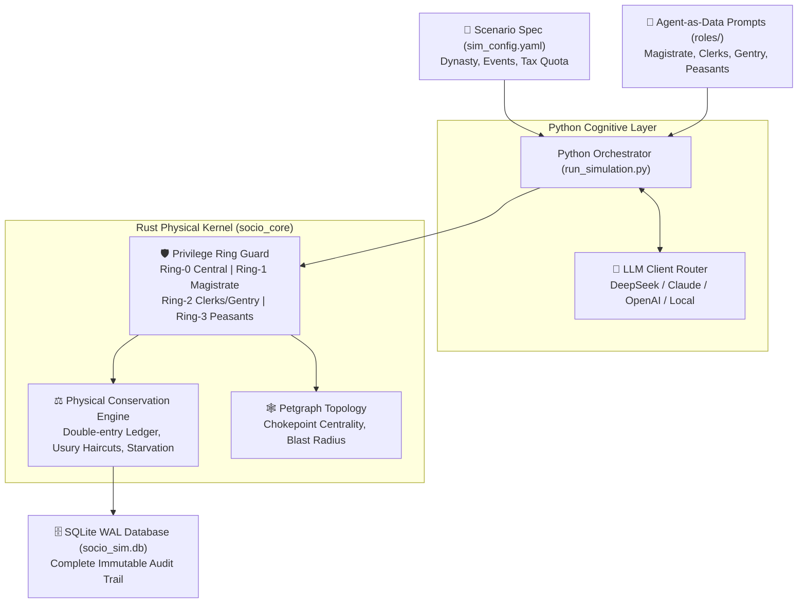

# Socio-Engine: Multi-Agent Historical & Social Systems Protocol Sandbox

> **Theoretical Foundation**: *Socio-Protocolics (社会系统协议学)* v11.2 (Orthogonal Axiomatic Foundation Edition)  
> **Core Architecture**: Rust Physical Privilege-Ring State Machine (PyO3) + Python Cognitive Agent-as-Data Architecture  
> **Historical SSOT**: Real historical records from Ming Dynasty Wanli archives (*Shexian County Gazettes*, *The Book of Silk* 1573–1577), extensible to any dynasty or civilization.

---

## 🌟 What is Socio-Engine?

**Socio-Engine** is an open-source, reproducible multi-agent historical and institutional simulation engine. It bridges two distinct layers of reality:
1. **Physical Conservation & Lawful Enforcement (The Ground Truth)**: Written in native Rust (`socio_core`), this layer strictly enforces double-entry conservation of silver, grain, and land, privilege ring permissions (Ring-0 to Ring-3), starvation thresholds, and graph-theoretic topological centrality.
2. **Cognitive Game Theory & Mental Models (The Human Agency)**: Driven by LLM-backed agents (DeepSeek / Claude / GPT / Gemini), agents act based on subjective expectations, family survival thresholds, and class utility functions $U_i$.

---

## 🏛️ System Architecture



---

## 🚀 Quick Start in 3 Minutes

### 1. Prerequisites
- Python 3.10+ (tested on Python 3.14)
- Rust & Cargo (1.80+)
- `pip install maturin pyyaml rusqlite`

### 2. Build and Install Native Rust Kernel
```bash
cd socio_engine/socio_core
maturin build --release
pip install --force-reinstall (ls ../target/wheels/*.whl | sort -Property LastWriteTime -Descending | select -First 1).FullName
cd ../..
```

### 3. Configure API Key
Copy the template and paste your API key (DeepSeek is recommended for extreme cost-efficiency and historical depth):
```bash
cp socio_engine/.env.example socio_engine/.env
# Edit socio_engine/.env and set:
# DEEPSEEK_API_KEY=sk-your-key-here
```

### 4. Run Classic Historical Experiments
```powershell
# Experiment 1: Northern Song Green Sprouts Reform & Tripartite Decoupling (Fixed Seed 42)
python socio_engine/run_simulation.py --config config/sim_config_wang_an_shi.yaml --ticks 4 --trial 1 --seed 42

# Experiment 2: Null Model Control Group (Random Dice Baseline, zero cognition)
python socio_engine/run_simulation.py --config config/sim_config_wang_an_shi.yaml --ticks 4 --trial 101 --mode dice --seed 42

# Run Cross-Trial Divergence and Institutional Attractor Audit
python socio_engine/scripts/compare_trials.py

# Experiment 3: The Hai Rui Institutional Breakthrough (8 quarters)
python socio_engine/run_simulation.py --version exp_hai_rui_breakthrough --trial 1 --config config/sim_config_hai_rui.yaml
```

---

## 📊 Recorded Experiments & Benchmark Findings

The included database (`database/socio_sim.db`, 2.2 MB) records **16 full simulation runs**:

| Experiment Version | Core Scenario | Magistrate Strategy | County Abandoned Land | Peasant Fleeing Ratio | Unrest Risk | System Entropy |
| :--- | :--- | :--- | :--- | :--- | :--- | :--- |
| **`v1.0` / `exp_mandate_conflict`** | Ming Wanli 1573–1577 Shexian | Gu Magistrate (Compromising Bureaucrat) | 13.0 mu | 40.0% | **83.0% (Near Revolt)** | 1.61 |
| **`exp_hai_rui_governance`** | Ming Wanli 1575 Reform | Hai Rui (Moral Purge Only) | **0.0 mu** | **0.0%** | **19.0%** | **2.97 (Clerk Strike)** |
| **`exp_hai_rui_breakthrough`** | Ming Wanli 1575 Reform | Hai Rui (Protocol Re-engineering: Recruit New Clerks + Direct Public Cadastre) | **0.0 mu** | **0.0%** | **19.0% (Stable)** | **2.61** |
| **`exp_blind_anonymized`** | Anonymized Cangshui County | Zero Ming Terms (Mechanistic Ablation) | Emerged rent extraction and debt bondage identical to real history |

---

## 🎨 Simulating Other Dynasties & Civilizations

Want to simulate the **Tang Dynasty Two-Tax Law (780 AD)**, **Song Dynasty Wang Anshi Green Sprouts Loan (1069 AD)**, or the **Roman Empire Price Edict (301 AD)**?

See our comprehensive guide and copy-pasteable meta-prompt:  
👉 **[Universal Scenario Prompt Template (docs/UNIVERSAL_SCENARIO_PROMPT_TEMPLATE.md)](./docs/UNIVERSAL_SCENARIO_PROMPT_TEMPLATE.md)**

---

## 🔒 Privacy & Open Science

- **No Secrets Tracked**: API keys are isolated in local `.env` (git-ignored).
- **Clean Audit**: `socio_sim.db` has been verified with 0 sensitive local path leaks or credentials.
- **Reproducible**: Every action proposal, token expenditure, and internal monologue is persisted in SQLite with WAL durability.

